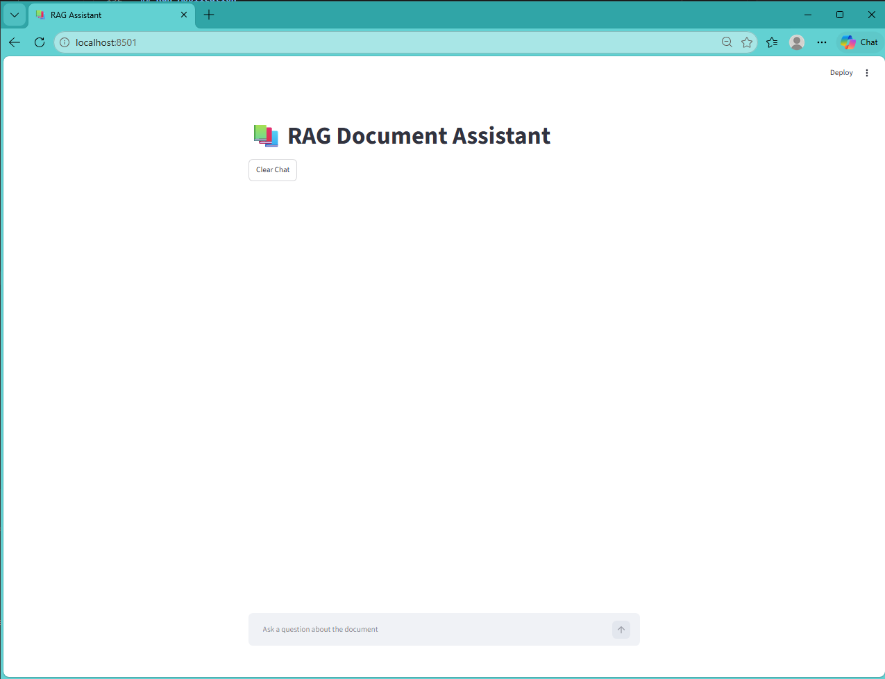
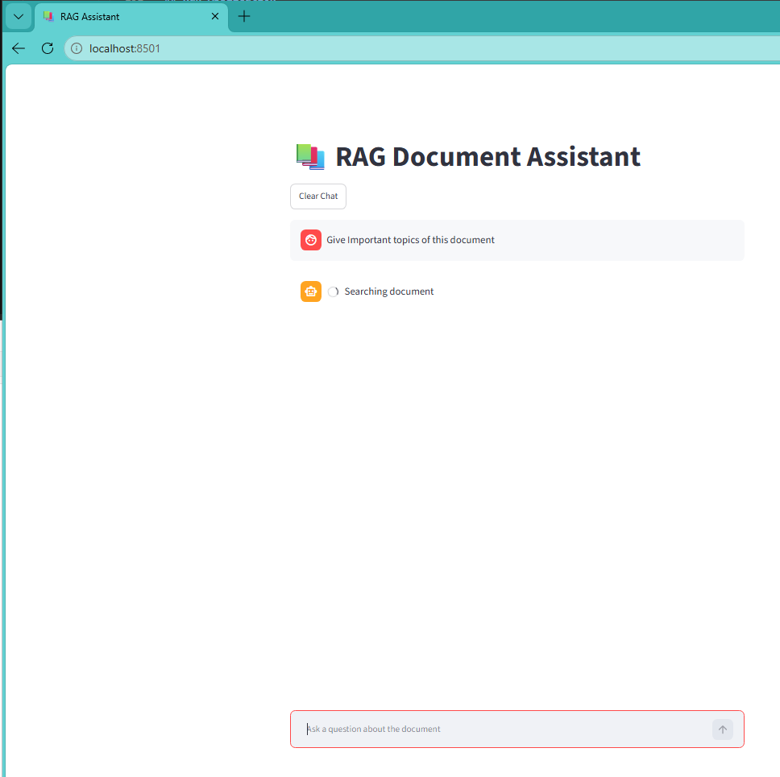
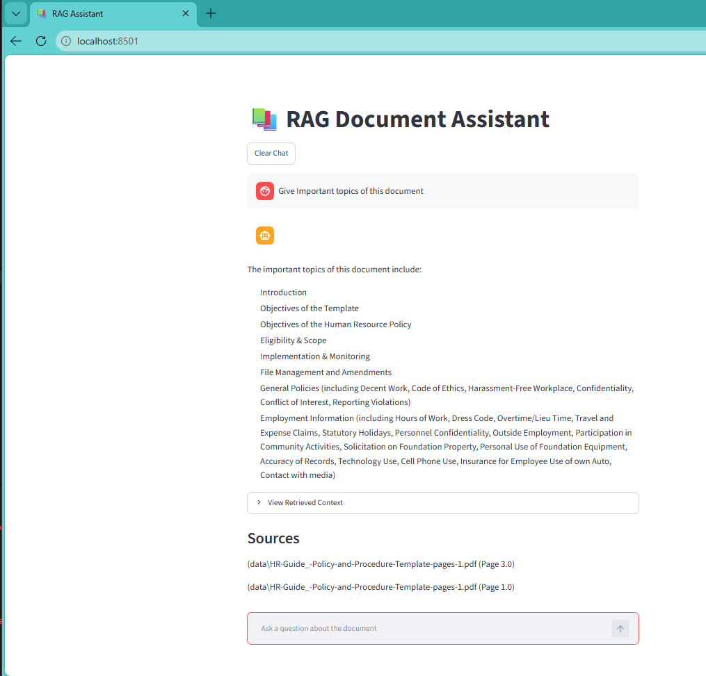
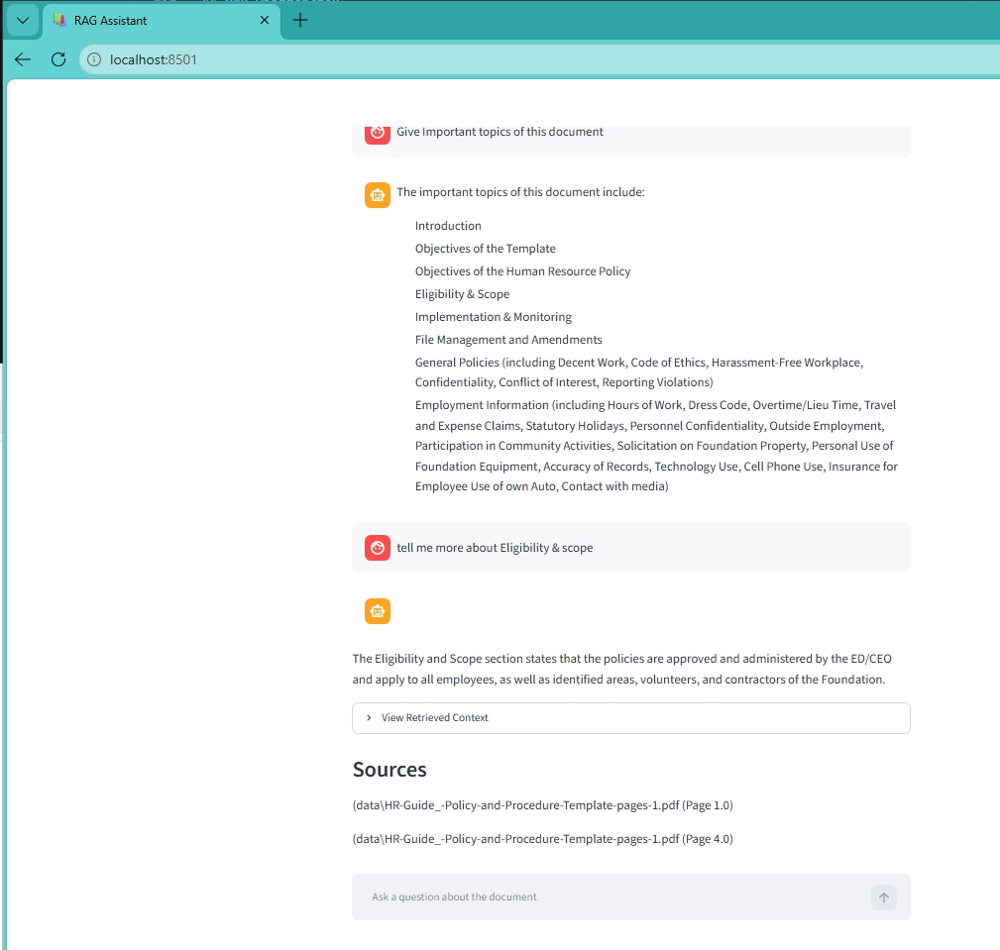
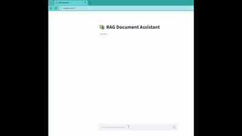

# RAG Document Assistant

A Retrieval-Augmented Generation (RAG) application built using LangChain, OpenAI, Pinecone, and Streamlit.

The application allows users to ask questions about uploaded documents. Instead of relying on the model's general knowledge, responses are generated using relevant information retrieved from the document embeddings stored in Pinecone.

---

## Features

- PDF Document Processing
- Text Chunking
- OpenAI Embeddings
- Pinecone Vector Database
- Semantic Search
- Retrieval-Augmented Generation (RAG)
- GPT-4o-mini Integration
- Source Citations
- Chat History
- Streamlit UI
- Retrieved Context Viewer

---

## Architecture

PDF Document
      │
      ▼
PyPDFLoader
      │
      ▼
Text Splitter
      │
      ▼
OpenAI Embeddings
(text-embedding-3-small)
      │
      ▼
Pinecone Vector Store
      │
      ▼
Retriever
      │
      ▼
GPT-4o-mini
      │
      ▼
Answer + Sources
---

## Tech Stack

| Component | Technology |
|------------|------------|
| Language | Python |
| Framework | LangChain |
| LLM | OpenAI GPT-4o-mini |
| Embeddings | OpenAI text-embedding-3-small |
| Vector Database | Pinecone |
| Frontend | Streamlit |
| PDF Processing | PyPDF |
| Environment Variables | python-dotenv |

---

## Project Structure

rag-document-assistant/
│
├── app.py
├── ingest.py
│
├── data/
│
├── src/
│   ├── document_loader.py
│   ├── splitter.py
│   ├── embeddings.py
│   ├── pinecone_setup.py
│   ├── vector_store.py
│   └── rag_chain.py
│
├── .env
├── requirements.txt
├── README.md
└── .gitignore
---

## Installation

### Clone Repository

```bash
git clone https://github.com/your-username/rag-document-assistant.git

cd rag-document-assistant
```

### Create Virtual Environment

```bash
python -m venv venv
```

### Activate Virtual Environment

Windows:

```bash
venv\Scripts\activate
```

### Install Dependencies

```bash
pip install -r requirements.txt
```

---

## Environment Variables

Create a `.env` file.

OPENAI_API_KEY=your_openai_api_key

PINECONE_API_KEY=your_pinecone_api_key

PINECONE_INDEX_NAME=rag-documents

---

## Index Documents

Place PDF files inside:

data/

Run:

```bash
python ingest.py
```

Expected:

Document indexed successfully

---

## Run Application

```bash
streamlit run app.py
```

Open:

http://localhost:8501


---

## Screenshots

### Home Screen



### Question Asked



### Answer Generated



### Follow up ques & Ans



---

## Demo



---

## Key Learnings

This project helped me understand:

- Retrieval-Augmented Generation (RAG)
- Vector Databases
- Embeddings
- Semantic Search
- Prompt Engineering
- Context Grounding
- LangChain Retrievers
- Pinecone Integration
- Streamlit Applications

---
